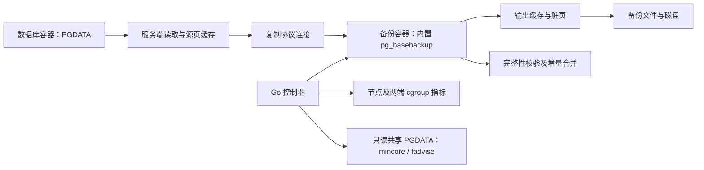

# pgcacheguard 的设计原理

文档状态：开发设计与已有证据。最终性能数值和验收结论另由正式测试报告给出，本文不把未完成实验写成已通过。

## 数据到底从哪里经过

一次原生物理备份可以分为：数据库后端读取 PGDATA → 内核页缓存 → 复制协议连接 → 备份客户端 → 输出文件页缓存及脏页 → 文件系统回写 → 底层磁盘。服务端还会准备备份检查点、产生或传输 WAL，客户端之后执行备份校验。增量恢复又增加读取父链、重建数据文件和校验合并产物的阶段。

把 TCP 改成 Unix Socket 可以避开该段 TCP 回环流量，但复制连接仍然传输数据。它既不是从数据库共享内存直接复制完整文件，也不会使源文件读取和输出写入自动绕过页缓存。[PG18 官方备份说明](https://www.postgresql.org/docs/18/app-pgbasebackup.html)

如果 PGDATA、备份目录和其他服务最终落在同一块设备，磁盘需要同时处理源读取、输出写入、WAL、检查点、回写和业务请求。标称顺序吞吐不是可同时分给所有工作的预算。很多小文件还会增加目录遍历、inode/dentry、open/stat 和小 IO 的成本；是否是主要原因，需要把这些指标与数据页缓存分开测。

## 为什么带宽有限速，内存仍可能上涨

限速控制每秒传多少数据。缓存能否及时回收，取决于页的状态、访问频率、脏页回写、内存压力和内核策略。较低速度只代表积累得更慢，不能推出累计缓存有确定上限。

Linux cgroup 的 `file` 包含 shmem，不能把整项都视为普通文件缓存。PostgreSQL 的共享缓冲区、进程匿名内存、扩展内存和 tmpfs/shmem，也不能由对 PGDATA 文件执行建议释放来消除。`active_file` 与 `inactive_file` 是页回收分类，不是“能释放”与“不能释放”的永久标签。[cgroup v2 内存统计](https://www.kernel.org/doc/html/latest/admin-guide/cgroup-v2.html)

Kubelet 的节点可用内存计算会排除其认为可回收的 inactive file；活跃文件缓存的增长可能压低这个指标。节点驱逐也不是只有容器超过 memory limit 才发生。Pod 的用量相对 requests、优先级以及是否超过请求量会影响排序，不能只用“requests 越小越容易驱逐”解释所有情况。[Kubernetes 驱逐机制](https://kubernetes.io/docs/concepts/scheduling-eviction/node-pressure-eviction/)、[相关历史 issue](https://github.com/kubernetes/kubernetes/issues/43916)

## 这个控制器是一个什么程序

它是独立的 Go 主程序，负责准入、锁、配置、监控、取消、结果记录和原生工具调度。PG18 客户端以静态可执行文件嵌入，运行时展开。客户端链接本项目的 C IO 适配代码，并对真实复制连接增加实例身份检查；没有把监控控制器写进 PostgreSQL 服务端，也不需要给数据库服务端注入 `LD_PRELOAD`。

正式原生路线不依赖 pgBackRest。早期研究中的 pgBackRest 包装方式只是对照原型，不构成最终产品的必需组件。

程序开始前检查路径、配置、预算和锁，拒绝在内存已经危险时开始。运行期间按 `poll_ms` 采样：节点低于警戒线时，将本次读写逻辑上限降到配置值的一半；低于停止线、受监控 cgroup 超预算、出现新的 OOM kill、监控失效或观察器异常时，取消自己的进程组。恢复到正常范围后恢复配置速率。当前不是可预测所有业务负载的调度器；业务安全预算仍须通过实测确定。

## 怎样处理备份目录

适配代码识别受控目录内的普通文件读写。输出达到窗口后执行必要写回，再对已完成的页发出 `POSIX_FADV_DONTNEED`。先写回是为了让干净页具备被丢弃的条件，而不是对着脏页反复发出没有效果的请求。

写回和释放按窗口进行，避免每写几 KiB 就同步、释放一次。读路径也采用完成范围的批处理；否则过于细碎的释放、禁用顺序预读和频繁睡眠可能把顺序扫描变成大量小 IO，降低吞吐、增加 IOPS。每个操作的请求字节与实际驻留变化分别统计，不能混为一谈。[Linux fadvise 语义](https://man7.org/linux/man-pages/man2/posix_fadvise.2.html)

## 客户端读不到源文件，怎样处理 PGDATA

客户端确实不是读取 PGDATA 的那个进程。普通目录备份中，观察器先以 `mincore` 保存共享源文件原有驻留页位图，再监听输出文件的完成进度。输出相应范围已经到达后，观察器根据路径和文件身份，给源端对应范围的原本冷页发出释放建议。

全量文件按字节范围对应。PG18 增量文件有块号映射，观察器解析增量头，把备份中的变化块映射回原文件。Linux 系统页可能是 4、16 或 64 KiB，不能把 PostgreSQL 的 8 KiB 数据块直接当作系统页。对于大系统页，需要等待该页涉及的变化块都已到达，再对整个系统页处理。

源端处理只读打开文件，不写数据、不 fsync 源文件、不改 PostgreSQL 的文件描述符。对消失、替换、缩短及未登记的新文件采取保守处理并记录；原有热页不主动释放。任务开始后业务新访问的冷页仍可能与备份范围重合，因此热页保护并非精确区分所有业务访问，必须测量业务延迟和缓存命中率。

原有位图也有成本：1.5 TiB 在 4 KiB 页下仅位图约 48 MiB，还要加文件路径、映射和 Go 元数据。程序设置位图预算，超预算时停止，而不无限增加自身内存。遍历十万级文件还会产生元数据开销，这也是正式规模实验必须测量的内容。

## 为什么可以跨容器

页缓存与同一宿主机中的底层文件对象相关，并非每个容器各有一份互不相通的文件缓存。备份容器只读挂载数据库实际卷中的同一文件，仍可以对打开的描述符发出建议。建议不会因此改写文件内容。原来被记账到哪个 cgroup，以及随后被回收后何时反映在统计中，应通过实际指标观察。[内核页缓存及建议接口](https://man7.org/linux/man-pages/man2/posix_fadvise.2.html)

已经完成的小实验使用相同 UID、只读挂载和无特权容器，核对设备号与 inode。对共享的 256 MiB 文件，两次测得驻留量降至 0，数据库容器对应 file 统计也下降。这证明该条件下的跨容器建议有效，不代表所有存储、权限和页状态都能保证相同结果。

必要条件包括：同一宿主机内核、同一实际文件、可读权限、准确驻留查询权限，以及文件系统支持。Linux 为防止信息泄露，可能对不具备权限的 mincore 查询返回全驻留伪装值。本工具优先要求执行 UID 与文件 UID 相同；对没有用户命名空间映射隔离、且实际持有 CAP_FOWNER 的 root 进程提供保守例外，以兼容已有管理程序。其他不明确情况拒绝执行，不把伪装值解释为真实热缓存。只读挂载并不妨碍所有者这一条件。OpenShift 随机 UID、SELinux/SCC、NFS 或不同卷副本要单独验收。[Linux 5.14 源码判断](https://github.com/torvalds/linux/blob/v5.14/mm/mincore.c)

## 和脚本调用 vmtouch / nocache 比，价值在哪里

| 项目 | 定期 vmtouch 释放脚本 | nocache 包装客户端 | pgcacheguard 当前设计 |
| --- | --- | --- | --- |
| 基础释放机制 | 对路径执行驻留查询/释放建议 | 拦截自身进程文件操作并建议释放 | 同样使用 mincore/fadvise；没有发明新的内核接口 |
| 原有热页 | 全目录 evict 容易影响原有缓存，具体取决于脚本 | 已有保留原来驻留页的设计 | 源端保存任务前位图，按备份进度处理；并非首次提出热页保护 |
| 源端实际读取者 | 可直接遍历 PGDATA，但缺少复制进度关系 | 包装 pg_basebackup 不会自动拦截服务端读取 | 通过只读共享卷和输出进度，处理符合条件的源范围 |
| 输出脏页 | 定时执行可能滞后，脏页未必能被丢弃 | 取决于实现和被覆盖的操作 | 按窗口写回并建议，错误进入任务状态 |
| 带宽与压力联动 | 需要另写限速和监控 | 不是数据库级完整资源控制器 | 配置上限、节点/cgroup 预算、降速/取消、共享锁统一管理 |
| 增量和恢复 | 脚本需自行组织父链与校验 | 不理解 PG18 增量恢复流程 | 保留原生格式，备份校验、链合并、合并后校验统一调度 |
| 完整性与证据 | 依脚本实现 | 不负责数据库备份可恢复性 | 区分命令成功、完整校验和实际恢复，保存结果 |
| 复杂度 | 简单、容易维护 | 通用、成熟、接入成本低 | 代码和验证成本更高，必须维护 PG 版本及文件格式适配 |

nocache 的说明明确包含 mincore 和原有页保护，也明确指出预加载拦截的边界；不能说它只能处理少数 open/close 调用，也不能保证静态链接、mmap、直接系统调用及另一个数据库进程自动被覆盖。[nocache 上游](https://github.com/Feh/nocache)、[vmtouch 上游](https://github.com/hoytech/vmtouch)

本工具的工程价值是把原生备份进度、两端缓存、业务资源预算、完整性和恢复证据组织成可验证的流程。是否优于维护良好的脚本，仍要由相同条件下的测试、故障行为和维护成本来判断。

## 工具解决不了的部分

一次检查点、同步服务的大查询、扩展内存、Python 整文件压缩、Redis 持久化及同盘其他服务，都可能独立消耗资源。工具退出后，不会继续约束 DBS 的后续 Python 代码。

停止复制也不能撤销已经提交给服务端的检查点或清除业务产生的脏页。DBS 当前使用的 `--checkpoint=fast` 会原样传入；仅有客户端限速不能保证其检查点阶段没有写入峰值。应在代表性写入负载下单独验收这个阶段，或者由调用配置选择 spread，并保留业务余量。

长期应把备份重负载从主业务路径移开：优先在专用备用库/备份节点执行；备份仓库使用独立设备；保留本地已经校验和演练的完整恢复副本；异地保存灾备副本。两个目录或两个 PVC 不一定是两块物理磁盘，必须核实实际设备拓扑。主备同步会复制逻辑变化，可能仍共享存储，隔离程度需以实际架构为准。

`memory.high` 可以触发回收和节流，不能只限制文件缓存；对整个数据库容器设置 IO 上限，也会同时影响 SQL 和 WAL。内存回收还可能增加读取/写回和延迟。这些控制适合作为经过容量验证的兜底，而不是替代两端缓存治理和容量规划。[cgroup v2 memory/io 控制](https://www.kernel.org/doc/html/latest/admin-guide/cgroup-v2.html)
