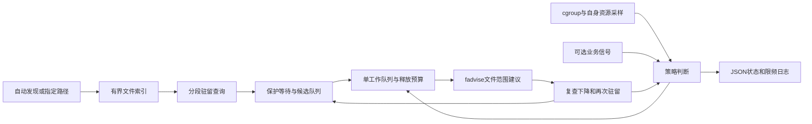

# 设计原理与边界

2026-11-17 / C039：当前拓扑改为DBS、HISDBS各自数据库、备份和一个CCG同容器；不再拆备份容器。见[完整同容器设计](SAME-CONTAINER.zh.md)与[rc.18计划](RC18-PLAN.zh.md)。rc.18实现与实测见[本版手册](RC18-USAGE.zh.md)及[交付](RC18-DELIVERY.zh.md)；原始计划按历史保留，生产闭环未验收。

## 1. 问题从哪里来

物理备份时，数据库服务端读取PGDATA，备份客户端写目标文件，两个进程分别产生源与输出缓存/脏页。本次将二者保留同一容器，通常共同计入同一个容器cgroup；实际分组要预检。备份限速不能为两个目录建立独立缓存硬上限，同一cgroup的io.max也不只限制备份。同步查询或顺序扫描同样会改变源缓存，与备份错开仍可能单独造成压力。

容器的 file、active_file、inactive_file、shmem、匿名内存不能混为一谈。Kubernetes 驱逐还涉及节点可用内存、requests、优先级等因素；调大 request 影响调度和驱逐排序，不等于主动减少缓存。限制 memory.high 触发的回收也可能带来额外 IO。CCG 不默认调整这些内核限制。

来源：[cgroup v2](https://docs.kernel.org/admin-guide/cgroup-v2.html)、[Kubernetes 节点压力驱逐](https://kubernetes.io/docs/concepts/scheduling-eviction/node-pressure-eviction/)。

## 2. 组成与数据流

每个数据库容器运行一个静态Go常驻进程。上图是已实现的常态文件后端：控制循环读取统计，一个工作goroutine维护目录、文件和区域，不按文件启动vmtouch或无限增加线程。工作系统调用阻塞时停止新建议，不创建替补工作者。Go运行时仍可能使用多个OS线程。rc.18已在此单工作队列内区分源/输出角色，共享总预算；可选内核后端另由节点agent及单个辅助进程受限执行，不是新的备份容器。

实现采用有预算的轮询，并可开启有上限的目录级 inotify 提示：关注读取、创建、写入关闭和移动进入，让近期发生访问的文件优先接受驻留查询。一个目录 watch 覆盖该目录的文件，不为每个页或每个文件创建 watch。内核会合并部分事件，但队列仍可能溢出，程序显示丢失/限额并保留慢速补扫。每轮最多读取16KiB事件数据，队列、watch数量和扫描工作都受预算限制。

事件没有读取偏移、频率保证或冷热含义，mmap 访问也不保证产生对应事件；不能把“看到访问”直接当成可回收证据。只改变采样优先级，保护期与反馈不绕过。不监听程序自身打开后产生的 CLOSE_NOWRITE，避免自激循环；测试覆盖 mincore 观测不产生访问提示。常态文件发现不依赖cachestat、eBPF或DAMON。rc.17新增的受限Unix Socket仅用于独立内核回收执行器，详见[手册](RC17-USAGE.zh.md)。

## 3. 两种范围模式

`auto` 通过挂载信息、常见数据目录和 PGDATA 找候选范围。`paths` 只使用用户明确填写的范围。两个模式共用同一套预算、文件安全和退让机制，不是自动模式可以绕过保护。

默认只观察。enforce 下，budget 模式在文件缓存超过软目标后开始；pressure 还等待用量超过高水位；always 可用于明确的一次性产物回收，但保护仍然有效。用户无需为每个文件设置规则，也可以通过排除目录保护热点。

## 4. 判断依据与不确定性

mincore 查询页是否驻留，不读取文件内容，但也不提供访问热度。第一次观察到驻留范围，先保护一段时间；之后允许小范围试探。释放后复查净下降，再延迟检查是否重新驻留。重新驻留明显时保护该范围、降低额度。

这些信号只能支持保守策略，不能证明“只淘汰冷页”。页面可能一直驻留且非常热；mtime 没变化也不能证明没人读取；重新驻留可能来自预读。内核的 workingset_refault_file 不覆盖所有手工建议后的再次读取，不能单独当误伤计数。[mincore](https://man7.org/linux/man-pages/man2/mincore.2.html)

启动时缓存没有永久特权，历史状态有界、会过期。一个大型文件以有限区域查询，不分配覆盖全库的位图。达到索引或区域预算就报告覆盖不足，不能把样本当全量精确统计。

## 5. 释放接口及其副作用

Linux `POSIX_FADV_DONTNEED` 针对打开文件的范围提供建议，可能释放干净文件页；内核不承诺全部释放。调用成功只能累计 advice_bytes。实际净变化另计，而且并发条件下不能把全部下降都归因于本程序。

该接口可能启动写回。CCG 不显式 fsync/fdatasync、不写源文件、不删除或截断文件、不调用全机 drop_caches，也不能因此声称完全没有写 IO。dirty/writeback、近期修改保护和外部业务信号用于降低风险；5.14 的接口无法提供严格、无竞态的逐页 clean-only 释放。[fadvise 手册](https://man7.org/linux/man-pages/man2/posix_fadvise.2.html)、[Linux 5.14 实现](https://github.com/torvalds/linux/blob/v5.14/mm/fadvise.c)

常态文件接口不释放应用堆、Redis数据、shared_buffers、tmpfs、shmem、socket或slab。rc.17已增加默认关闭的memory.reclaim后端，受限调用整个登记cgroup，不能继承目录排除或承诺只动文件页，也不承诺anon/shmem/slab定向回收。同容器后它同时覆盖数据库和备份，资格与副作用须单独验收，见[内核手册](RC17-USAGE.zh.md)。

## 6. 保护状态

| 状态 | 原因 | 行为 |
| --- | --- | --- |
| OBSERVE | 只观察或启动学习 | 不释放 |
| IDLE | 未达到触发条件 | 预算内发现与观察 |
| CONTROL | 达到目标且保护允许 | 有限建议、复查与速率调整 |
| CONTROL_CRITICAL | 显式 critical_mode=bounded 且其它保护允许 | 在原预算内继续处理经验证范围，不增加额度、不绕过保护 |
| BACKOFF | 脏页、IO、业务或自身成本越界 | 停止新释放；自身成本越界还暂停工作队列 |
| SUSPENDED | 用户暂停、指标错误、目标缺失或工作阻塞 | 不派发新建议，明确原因 |
| CRITICAL | 临界内存、低节点余量或新 OOM kill | 停止推测性回收，等待人工/上层处理，不杀业务、不扩大无效回收 |
| STOPPED | 用户停止或时长结束 | 退出，保留最终状态 |

常态文件后端按其启动基线识别新增OOM并保持保护；重启不等于问题已经解除。rc.17内核后端更严格地拒绝未处理的历史/父级OOM，不能靠重启或删journal绕过。宿主MemAvailable只是可选保护，不是kubelet真实驱逐口径；已有来源绑定JSON输入，rc.18提供schema2采集命令，但生产同容器真实信号闭环仍未验收。停止新建议不承诺能中断内核不可中断IO。

默认 critical_mode=pause。对明确的低复用备份输出，经实测后可用 bounded 避免“缓存很高 → 停止处理 → 长期不再下降”的停滞，但它不是紧急 OOM 救援。写回导致建议暂时无效时，复查可保留候选，同一轮最多三次建议尝试；重新驻留保护优先于重试。不能从系统调用成功直接认定缓存已经释放。

## 7. 路径、权限与共享文件

支持时使用 openat2 的 NO_SYMLINKS/NO_MAGICLINKS，减少深路径逐级打开的系统调用成本；内核或 seccomp 不支持时，退回逐级目录 FD 和 O_NOFOLLOW。百万文件首次发现使用已安全打开的父目录 FD、相对 `O_PATH|O_NOFOLLOW` 只读取子项元数据，减少重复完整路径解析；若内核或 seccomp 拒绝该调用，会回退到原安全打开路径并显示 `fast_discovery_fallback=true`。两种路径都阻止父路径/末级符号链接绕开范围，不为提高速度放宽规则。只处理支持文件系统的普通文件；记录设备、inode、大小和修改时间，操作前再检查，文件改变则丢弃旧状态。它无法消除所有并发 rename/write 竞态，也不应被当作对恶意内核或特权对手的隔离边界。[openat2 接口](https://man7.org/linux/man-pages/man2/openat2.2.html)

mincore 有信息访问限制。普通读取权限不总能保证真实驻留结果；第一版要求同 UID，或在初始用户命名空间具有 CAP_FOWNER 的 root。无法确认时跳过并报错。只读挂载可以发建议，是否成功仍取决于权限、文件系统、SELinux/seccomp 等实际条件。

同容器直接使用源/输出的原挂载，不需要跨容器共享PGDATA。共享同设备、同inode文件的其他进程/容器仍可能受文件建议影响，路径范围不等于计费所有权。通用sidecar机制保留作历史/其他环境参考，不属于本次拓扑；同一范围只部署一个执行权威。

## 8. 参考了哪些项目

| 项目 | 借鉴点 | 不直接作为本产品的原因 |
| --- | --- | --- |
| [vmtouch](https://github.com/hoytech/vmtouch) | 文件驻留查询、范围建议 | 它的锁页/后台模式不是本产品的压力反馈策略 |
| [nocache](https://github.com/Feh/nocache) | 保存已有驻留、在文件生命周期边界处理 | LD_PRELOAD 不自动覆盖独立数据库后端、所有静态或直接 syscall 程序 |
| [pcstat](https://github.com/tobert/pcstat) | Go 驻留观测和结构化结果 | 侧重测量，不是策略控制器 |
| [pagers](https://github.com/LilDojd/pagers) | 有界处理、cachestat/mincore 回退 | 锁页相关 daemon 不等于自动反馈治理 |
| [fincore](https://github.com/util-linux/util-linux/blob/master/misc-utils/fincore.c) | 独立交叉检查 | 不负责完整控制闭环 |
| [Senpai](https://github.com/facebookincubator/senpai) | 小步试探和压力退让 | memory.high 整体回收不具备路径排除，可能产生 IO 代价 |
| [DAMON](https://github.com/damonitor/damo) | 时间/字节预算和水位 | 需要实际内核接口与权限能力，不能仅看版本号推断 |
| [BCC](https://github.com/iovisor/bcc) | 短时定位缓存访问来源 | 探针兼容、权限和事件成本；不是现成回收策略 |
| [cache_ext](https://github.com/cache-ext/cache_ext) | 未来定制淘汰研究 | 上游实验涉及修改 Linux 内核，非当前环境即装即用 |

核心实现未复制上述项目代码。rc.17内核后端已经候选交付，保持默认关闭和实际验收边界；rc.18补齐角色、任务包装与保护输入接口，不因候选发布宣布现场问题已解决。
