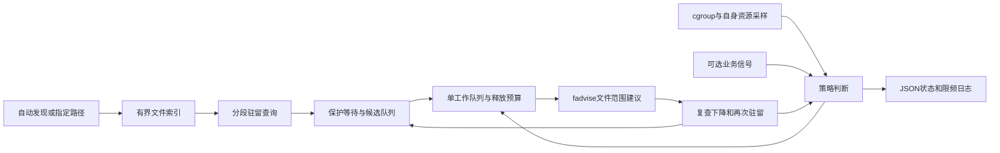

# 设计原理与边界

## 1. 问题从哪里来

备份客户端和数据库不是同一个读 IO 发起者。物理备份时，数据库服务端读取 PGDATA，页缓存可能记账在数据库容器；备份客户端写目标文件，又产生输出端页缓存和脏页。客户端限速能限制部分吞吐，但不能直接为两侧缓存建立硬上限。同步程序执行查询或顺序扫描也会改变数据库缓存，与备份时间完全错开仍可能单独造成压力。

容器的 file、active_file、inactive_file、shmem、匿名内存不能混为一谈。Kubernetes 驱逐还涉及节点可用内存、requests、优先级等因素；调大 request 影响调度和驱逐排序，不等于主动减少缓存。限制 memory.high 触发的回收也可能带来额外 IO。CCG 不默认调整这些内核限制。

来源：[cgroup v2](https://docs.kernel.org/admin-guide/cgroup-v2.html)、[Kubernetes 节点压力驱逐](https://kubernetes.io/docs/concepts/scheduling-eviction/node-pressure-eviction/)。

## 2. 组成与数据流

一个静态 Go 进程。控制循环读取少量统计文件，一个工作 goroutine 维护目录、文件和区域状态并执行操作，不为每个文件启动 vmtouch，不按 CPU 数量无限增加线程，也不启动 LD_PRELOAD 包装器。若文件系统调用阻塞，只会有一个工作队列占用；控制侧报告延迟并停止新的建议，不创建替补工作者。Go 运行时本身仍可能使用多个 OS 线程，`GOMAXPROCS=1` 不是整个进程仅有一个线程的保证。

实现采用有预算的轮询，并可开启有上限的目录级 inotify 提示：关注读取、创建、写入关闭和移动进入，让近期发生访问的文件优先接受驻留查询。一个目录 watch 覆盖该目录的文件，不为每个页或每个文件创建 watch。内核会合并部分事件，但队列仍可能溢出，程序显示丢失/限额并保留慢速补扫。每轮最多读取16KiB事件数据，队列、watch数量和扫描工作都受预算限制。

事件没有读取偏移、频率保证或冷热含义，mmap 访问也不保证产生对应事件；不能把“看到访问”直接当成可回收证据。只改变采样优先级，保护期与反馈不绕过。不监听程序自身打开后产生的 CLOSE_NOWRITE，避免自激循环；测试覆盖 mincore 观测不产生访问提示。cachestat、Unix 管理 Socket、eBPF、DAMON 不是当前已实现能力。

## 3. 两种范围模式

`auto` 通过挂载信息、常见数据目录和 PGDATA 找候选范围。`paths` 只使用用户明确填写的范围。两个模式共用同一套预算、文件安全和退让机制，不是自动模式可以绕过保护。

默认只观察。enforce 下，budget 模式在文件缓存超过软目标后开始；pressure 还等待用量超过高水位；always 可用于明确的一次性产物回收，但保护仍然有效。用户无需为每个文件设置规则，也可以通过排除目录保护热点。

## 4. 判断依据与不确定性

mincore 查询页是否驻留，不读取文件内容，但也不提供访问热度。第一次观察到驻留范围，先保护一段时间；之后允许小范围试探。释放后复查净下降，再延迟检查是否重新驻留。重新驻留明显时保护该范围、降低额度。

这些信号只能支持保守策略，不能证明“只淘汰冷页”。页面可能一直驻留且非常热；mtime 没变化也不能证明没人读取；重新驻留可能来自预读。内核的 workingset_refault_file 不覆盖所有手工建议后的再次读取，不能单独当误伤计数。[mincore](https://man7.org/linux/man-pages/man2/mincore.2.html)

启动时缓存没有永久特权，历史状态有界、会过期。一个大型文件以有限区域查询，不分配覆盖全库的位图。达到索引或区域预算就报告覆盖不足，不能把样本当全量精确统计。

## 5. 释放接口及其副作用

Linux `POSIX_FADV_DONTNEED` 针对打开文件的范围提供建议，可能释放干净文件页；内核不承诺全部释放。调用成功只能累计 advice_bytes。实际净变化另计，而且并发条件下不能把全部下降都归因于本程序。

该接口可能启动写回。CCG 不显式 fsync/fdatasync、不写源文件、不删除或截断文件、不调用全机 drop_caches，也不能因此声称完全没有写 IO。dirty/writeback、近期修改保护和外部业务信号用于降低风险；5.14 的接口无法提供严格、无竞态的逐页 clean-only 释放。[fadvise 手册](https://man7.org/linux/man-pages/man2/posix_fadvise.2.html)、[Linux 5.14 实现](https://github.com/torvalds/linux/blob/v5.14/mm/fadvise.c)

程序治理普通文件缓存。应用堆、Redis 数据、shared_buffers、tmpfs、shmem、socket、slab 不通过这个接口释放。没有尝试用全局清理冒充“容器其它缓存管理”。有条件的 cgroup memory.reclaim 或应用插件属于后续评估，它们的权限、作用范围和 swap/IO 影响要单独验收。

## 6. 保护状态

| 状态 | 原因 | 行为 |
| --- | --- | --- |
| OBSERVE | 只观察或启动学习 | 不释放 |
| IDLE | 未达到触发条件 | 预算内发现与观察 |
| CONTROL | 达到目标且保护允许 | 有限建议、复查与速率调整 |
| BACKOFF | 脏页、IO、业务或自身成本越界 | 停止新释放；自身成本越界还暂停工作队列 |
| SUSPENDED | 用户暂停、指标错误、目标缺失或工作阻塞 | 不派发新建议，明确原因 |
| CRITICAL | 临界内存、低节点余量或新 OOM kill | 停止推测性回收，等待人工/上层处理，不杀业务、不扩大无效回收 |
| STOPPED | 用户停止或时长结束 | 退出，保留最终状态 |

OOM 事件相对启动基线增加后保守保持 CRITICAL，需调查后重启，不自动忘记这次事件。节点 MemAvailable 仅是可选保护信号，当前没有 kubelet Summary 集成。超时目标是正常调度下下一次采样停止新建议，不承诺中断内核中的不可中断 IO。

## 7. 路径、权限与跨容器

支持时使用 openat2 的 NO_SYMLINKS/NO_MAGICLINKS，减少深路径逐级打开的系统调用成本；内核或 seccomp 不支持时，退回逐级目录 FD 和 O_NOFOLLOW。两种路径都阻止父路径/末级符号链接绕开范围，不为提高速度放宽规则。只处理支持文件系统的普通文件；记录设备、inode、大小和修改时间，操作前再检查，文件改变则丢弃旧状态。它无法消除所有并发 rename/write 竞态，也不应被当作对恶意内核或特权对手的隔离边界。[openat2 接口](https://man7.org/linux/man-pages/man2/openat2.2.html)

mincore 有信息访问限制。普通读取权限不总能保证真实驻留结果；第一版要求同 UID，或在初始用户命名空间具有 CAP_FOWNER 的 root。无法确认时跳过并报错。只读挂载可以发建议，是否成功仍取决于权限、文件系统、SELinux/seccomp 等实际条件。

跨容器访问同设备、同 inode 的文件时，共享该文件页缓存，因此一个容器的建议会影响其它读者。路径范围不等于 cgroup 记账所有权；不能宣称只释放了某一个容器独占的页。sidecar 必须明确监控哪个业务 cgroup。同一范围只部署一个执行者，避免多个实例互相影响。

## 8. 参考了哪些项目

| 项目 | 借鉴点 | 不直接作为本产品的原因 |
| --- | --- | --- |
| [vmtouch](https://github.com/hoytech/vmtouch) | 文件驻留查询、范围建议 | 它的锁页/后台模式不是本产品的压力反馈策略 |
| [nocache](https://github.com/Feh/nocache) | 保存已有驻留、在文件生命周期边界处理 | LD_PRELOAD 不自动覆盖独立数据库后端、所有静态或直接 syscall 程序 |
| [pcstat](https://github.com/tobert/pcstat) | Go 驻留观测和结构化结果 | 侧重测量，不是策略控制器 |
| [pagers](https://github.com/LilDojd/pagers) | 有界处理、cachestat/mincore 回退 | 锁页相关 daemon 不等于自动反馈治理 |
| [fincore](https://github.com/util-linux/util-linux/blob/master/misc-utils/fincore.c) | 独立交叉检查 | 不负责完整控制闭环 |
| [Senpai](https://github.com/facebookincubator/senpai) | 小步试探和压力退让 | memory.high 整体回收不具备路径排除，可能产生 IO 代价 |
| [DAMON](https://github.com/damonitor/damo) | 时间/字节预算和水位 | 需要实际内核接口与权限能力，不能仅看版本号推断 |
| [BCC](https://github.com/iovisor/bcc) | 短时定位缓存访问来源 | 探针兼容、权限和事件成本；不是现成回收策略 |
| [cache_ext](https://github.com/cache-ext/cache_ext) | 未来定制淘汰研究 | 上游实验涉及修改 Linux 内核，非当前环境即装即用 |

核心实现未复制上述项目代码。是否将内核后端加入未来版本，以实测收益、可部署性与许可证核查为依据。
