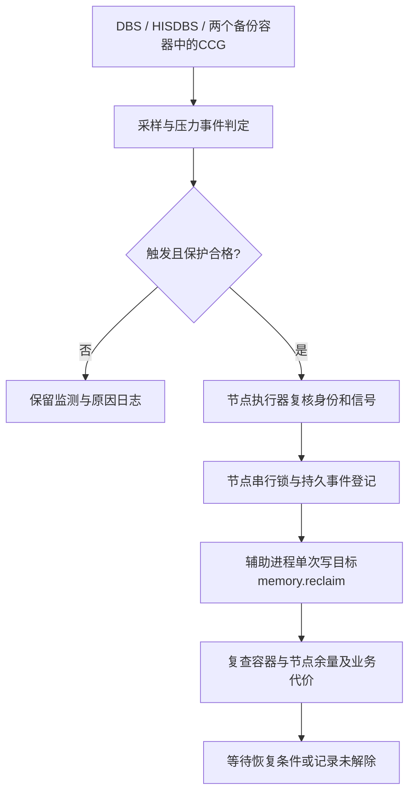

# rc.17设计：驱逐前单次内核主动回收

> C038实现更新：rc.17候选代码、双架构原生回归及真实内核短时隔离实验已交付，见[实际结果](RC17-DELIVERY.zh.md)与[可运行配置](RC17-USAGE.zh.md)。下文“尚未编码”等状态保留C037原始设计时间点；不是当前实现状态。生产schema2采集、94部署、无PSI真实盘及长稳仍未验收。

日期：2026-11-12；需求C037。**这是下一版设计，尚未编码、测试或发布。当前最新候选仍为rc.16。** 本轮不连接171/94，不部署、不写memory.reclaim、不调整内存/CPU/IO配额。

## 1. 这项功能解决什么问题

用户希望：容器内存接近危险区域时，由常驻CCG主动调用一次memory.reclaim，为业务争取内存余量，降低OOM或Kubernetes内存驱逐风险。

建议增加“内核主动回收”后端，与现有按文件范围的fadvise后端共存。正常时沿用原有治理；进入预警区且资格检查通过时，每个压力事件最多提交一次内核请求，随后观察结果。应急调用不依赖PGDATA文件发现、执行位过滤或目录索引是否完整。

它是**降低风险的主动干预**，不是“确保不被驱逐”的承诺。内核回收量、写回和重新读入成本，以及调用能否赶在业务分配/驱逐之前完成，必须实测。

## 2. 已知事实、推断与待验证事项

| 层级 | 内容 |
| --- | --- |
| 既有只读现场证据 | 源环境为cgroup v2；厂商5.14内核；两库目标cgroup有memory.reclaim；swap.max/current均0。只有接口元数据，没有执行回收，也未验证实际程序的写权限、SELinux或委派。原始地址、日志及容器标识不随本设计公开。 |
| 已有产品事实 | rc.16采用逐文件mincore/fadvise及反馈退让；没有memory.reclaim后端。严格策略需要PSI等有效输入；现场PSI缺失，多项业务/IO/节点保护尚未启用。 |
| 接口事实 | memory.reclaim对目标cgroup发起回收，请求数量不是保证值，回收不足可返回EAGAIN；作用范围不受CCG目录排除规则限制。[内核文档](https://docs.kernel.org/admin-guide/cgroup-v2.html#memory-interface-files) |
| 设计推断 | 内核后端能避开部分逐文件覆盖问题，但是否改善驱逐余量取决于实际被回收的内存和kubelet统计口径；不能从接口存在直接推导有效。 |
| 待验证 | 厂商内核的准确语义、真实权限、调用延迟、共享计费、GiB级收益、热点影响、双库/双备份并发，以及真实节点驱逐对照。 |

上游早期实现与较新实现的参数解析不同。首版只发送页对齐的十进制字节数，不假设厂商内核支持swappiness等扩展，也不在生产尝试写0或非法参数来探测能力。[早期实现](https://github.com/torvalds/linux/blob/v5.19/mm/memcontrol.c)、[较新实现](https://github.com/torvalds/linux/blob/v6.12/mm/memcontrol.c)。

## 3. 必须分别处理两类风险

### 3.1 容器或父级cgroup接近上限

对目标叶子cgroup及可见有限上限祖先，分别读取L=memory.max、C=memory.current，计算余量H=L−C。不能只检查容器自身；父级被同组其他服务占满时，子容器仍可能受到影响。各层的计数不相加，逐层取最紧迫的风险。

初始候选：普通治理在85%附近预警；内核干预在90%附近触发，或任一有效层剩余不到1GiB时触发。若已有连续有效样本，根据近窗口的正增长速度估计到达上限的时间；预计20秒内触线可以提前触发。预测只是辅助，缺少增长基线时标记未知，不填0，也不宣称能预测突发分配。

90%/1GiB/20秒都是待标定参数，非现场安全结论。例如HISDBS上限15GiB时，90%约13.5GiB；DBS上限30GiB时约27GiB。历史OOM锁定优先，不能靠新功能绕过DBS已存在的保护。

### 3.2 节点接近kubelet内存驱逐阈值

使用同一节点、真实来源的kubelet内存信号与有效驱逐配置；不仅看容器百分比，也不能用free/MemAvailable替代kubelet口径。硬驱逐没有可依赖的宽限期，因此不能等待Evicted事件、终止钩子或MemoryPressure才启动。[Kubernetes说明](https://kubernetes.io/docs/concepts/scheduling-eviction/node-pressure-eviction/)

节点信号需覆盖适用的node memory.available，以及启用Node Allocatable约束时的pods/system-container可用内存。兼容实际kubelet版本，将硬/软阈值、百分比所用容量、软阈值宽限期、evictionMinimumReclaim及来源时间一并归一化。缺少的约束不能用另一个信号冒充。[v1.26实现参考](https://github.com/kubernetes/kubernetes/blob/v1.26.12/pkg/kubelet/eviction/helpers.go)

对每个实际生效的约束，设A为可用内存、E为有效阈值：

- 固定预警余量M初始取1GiB，节点触发线为E+M。
- 有足够样本时，按可用内存下降速度扩大M，覆盖**原始样本年龄+采集周期+确认等待+调用观察预算**；配置值只能作为最低余量。
- 不能通过重复读取旧kubelet样本刷新时间。原始样本过期或阈值未知时，节点预防能力不就绪。
- 已跨硬驱逐线或已明确进入驱逐流程，记录too_late_or_unknown；本版不追加调用并声称可以取消驱逐。仍保留监测与结果记录。

节点信号接口拟扩展为schema 2，逐项携带node/allocatable约束、可用量/工作集/容量、有效硬/软阈值及宽限期、minimum reclaim、原始观测时间、配置来源版本，以及node/source/boot身份。沿用有界JSON与防重复键/时间回退检查；适用约束缺失时不能填0。旧schema 1继续服务原文件后端，不能冒充已经覆盖新增的allocatable判断。内核后端的候选新鲜度上限：直接cgroup样本2.5秒、真实业务/磁盘信号5秒、kubelet原始样本15秒；均需校验原始时间，较慢节点采样的风险由动态余量明确反映，而非伪造更快采样。

### 3.3 最容易误判的地方：inactive_file

kubelet通常已经将inactive_file从工作集计算中扣除。因此，回收一批inactive_file后，memory.current可能下降，而kubelet memory.available改善很小。**容器内存下降与驱逐风险改善要分别验收。** 这也是不能仅以释放了多少GiB宣布成功的原因。[官方口径](https://kubernetes.io/docs/concepts/scheduling-eviction/node-pressure-eviction/#eviction-signals)

## 4. 部署架构：容器负责判断，节点端负责受限执行



推荐四容器方案：每个业务/备份容器保留CCG；同一节点新增一个受限执行器，由**同一个静态二进制**的独立子命令运行。执行器可以作为宿主机服务，或经明确授权的节点DaemonSet。只管理登记的四个叶子cgroup，不写公共kubepods父级、不写根cgroup。

容器通过受限本地Unix Socket提交压力事件，不提供Web或HTTP/TCP监听，不接受任意shell命令或客户端提供的任意cgroup路径。节点执行器用本地对端凭据、运行时容器/Pod身份、节点boot ID及cgroup设备/inode核对登记关系；重新检查策略，不把客户端请求当成授权。给单个业务容器挂载受限Socket即可，不默认向每个容器暴露整棵可写cgroupfs。

执行器从已验证的cgroup2挂载根，通过不跟随符号链接的目录FD定位已登记目标，打开固定的memory.reclaim文件；提交前重新核对目标身份。客户端消息有大小/速率/等待时限，不能让其选择任意路径、FD、请求量或子进程参数。节点/业务/IO信号从受保护的可信文件取得，不相信客户端自报“健康”。Socket身份登记、委派、SELinux/OpenShift SCC适配与实际最小权限均须在94验证，不把root或rw挂载元数据当作授权验收。

普通CCG继续独立工作；执行器不可用时，新增应急能力显示unavailable，不能静默宣布保护成功。节点执行器应有独立、预留的CPU/内存预算，避免和目标容器一起在极限状态下失去响应；具体预算先测，不默认加不可驱逐优先级或修改集群保留量。

另保留自容器执行适配器用于单容器/隔离验证：只允许当前真实叶子cgroup，须具备实际写权限。四容器生产接入统一走节点执行器，避免四个进程同时回收同一块底层盘。只以root运行并不足以证明拥有写权限。

## 5. 一次调用的精确定义

采用**一个压力事件最多一次写尝试**，不是每秒一次，也不是进程启动一次。

1. 同一组容器/父级/节点预警同时出现时合并为一个episode，记录多个触发原因。
2. 连续3个有效1秒采样确认；增长预测可使预警线提前，不绕过样本确认或保护。
3. 节点端去重同一目标事件，取得节点串行许可；执行前再次读取真实余量及目标身份。等待期间已恢复，则不执行。
4. 在受限持久目录写入保留记录，登记episode ID、boot ID、cgroup身份、时间、请求字节和状态，然后才允许调用。记录无法持久化则不调用。
5. **最多执行一次write系统调用**。EAGAIN、EINTR、参数错误或结果不明均不自动再写，不以参数回退做第二次尝试；短写/中断只记结果未知。
6. 用量低于85%、节点高于触发线再加512MiB且所有相关压力源持续健康60秒，距离上次事件至少5分钟，才重新武装。只过冷却时间、压力仍未恢复时，不能产生新事件。
7. 重启恢复既有事件；reserved/running/unknown状态保守视为已消耗次数，避免崩溃后重复回收。OOM历史/锁定保留，重启不构成事故解除。

语义是at-most-once尝试，不是假装实现“崩溃前后必定执行且恰好执行一次”。启动后无法确认旧调用结果时，宁可保持unknown，不重复冲击磁盘。

节点同一时间只有一个在途回收；初始候选再限制节点调用间隔30秒、5分钟内请求总量不超过1GiB。备份容器优先于数据库容器，在有合格文件估算和真实压力的登记目标中选择；不对未登记Redis/etcd等服务发起回收。队列有界、单目标只保留一条待处理事件，排队不代表一定会执行。

## 6. 请求多少内存

不能把“全部缓存”作为请求。先给出可审计的保守估算：

```text
F = max(file − shmem − file_dirty − file_writeback, 0)
D = 恢复到容器/父级/节点预警线之上所需的目标余量
R = 按页向下对齐 min(D, 单次请求上限, F × 文件预算比例, 节点剩余请求预算)
```

F只是准入/额度估算，不是已确认的干净、冷或一定能回收的页数。D按当前触发来源分别计算，在同一事件选择足以覆盖相关缺口的目标；节点缺口与容器释放量不是一一对应，日志须明确。

候选默认：F至少512MiB、预算比例25%、单次请求上限512MiB、最小请求64MiB。算出的R不足64MiB则跳过，不向上凑数突破预算。额度不够恢复目标时明确记录insufficient_budget，不能写完一次后偷偷追加。

首次94隔离实验从128/256MiB请求起，测试充分后再评估512MiB或1GiB配置。**这些上限只约束请求量，不是内核实际回收、物理IO或耗时的硬上限。** 大请求可能打掉热点或启动写回；禁止把“1GiB/s回收”解释成准确可控的内核吞吐。

## 7. 回收范围与swap规则

memory.reclaim处理目标cgroup及其子树的内核可回收对象；CCG首版只允许已登记、没有子业务cgroup的叶子目标。共享页按实际计费关系处理，不保证只影响目标容器的读者。

**paths、exclude_paths、WAL排除以及逐文件热点保护不能约束这个后端。** 它不是“对PGDATA/base执行强力fadvise”，也不是严格的clean-only/file-only接口。开启配置必须显式接受scope=cgroup；要求目录级隔离的场景保持原后端。

首版默认require_swap_disabled：目标memory.swap.max=0且memory.swap.current=0，执行前复核，并检查相关子树条件。不能确认或启用了swap时，新增后端不就绪；不自动改变swap、swappiness或内存限制。只采用基本字节数参数，避免厂商扩展不兼容。禁止回收/清空应用逻辑数据，不声称可任意丢弃PG shared_buffers、匿名页、shmem或全部slab。

## 8. 保护判定如何与旧机制共存

新增独立的kernel_reclaim决策，不能简单让旧policy返回allow=true。原文件后端判定保持原样，避免为应急功能意外放开普通扫描。

| 条件 | 新增后端行为 |
| --- | --- |
| observe、用户暂停、未显式开启 | 不调用 |
| 容器/父级进入预警区 | 可成为触发原因；仅对本后端不沿用“用量高就暂停”的旧否决，否则新增功能永远无法工作 |
| 新OOM、未解除的OOM锁定、已有unknown在途请求 | 保持锁定，不绕过，不重启清基线 |
| 脏页/写回过多、IO/业务/refault越界、自身资源超预算 | 拒绝新调用；已在内核中的调用不能假装即时撤销 |
| 信号过期/回退、来源不匹配、目标重建、权限不明 | 拒绝并写具体原因 |
| 已越硬驱逐线或目标已进入终止 | 不追加“最后一搏”，记录预防窗口已丢失 |
| 压力已恢复 | 取消尚未提交的请求；已提交后只观察，不重复 |

strict为默认，要求有效PSI、IO/refault、真实业务及适用节点信号。**源环境缺PSI，直接照搬strict不能启用。** 为其设计显式实验资格`no-psi-guarded`：仅在确认接口不存在、而非权限/读失败时允许；必须有新鲜真实业务p99/错误率、底层共享盘延迟/队列、IO/refault与节点/父级信号，使用更小128MiB请求上限，保持其余保护。IO字节数不等价于IO停顿，替代信号也不宣称与PSI等价。

该资格与已有limited-output不同：不能把源PGDATA或整个数据库cgroup伪装成低复用备份输出。没有上述补充信号时先保持observe/unavailable，不为“能启动”把未知当健康。实验资格必须单独通过真实内核和业务验收，才能作为现场候选。

## 9. 防止一次调用拖垮监控

写接口由同一二进制重新启动的受限辅助进程执行，主采样循环不进入阻塞write。辅助进程只获得已核验的目标/必要FD，不使用shell。

- 请求发出前暂停该目标的新增fadvise，避免两后端重叠干预；采样、日志及必要只读复查继续。观察前30秒保持该目标fadvise暂停，随后按正常保护恢复。
- watchdog初始2秒：超时记录deadline_exceeded，尝试中止辅助进程，**不承诺2秒硬终止内核中的不可中断IO**。
- 超时/客户端断开后不创建新的辅助进程补救；节点串行锁由实际在途进程/执行器持续持有，不能仅因TTL到期而放行下一次调用。保留pid启动身份，防止PID复用。
- 辅助进程和执行器CPU/RSS/IO纳入自己的预算与日志，不隐藏为低开销；子进程未退出时持续标为inflight_unknown。
- EAGAIN可能已产生部分效果，应记录返回码并复查，不将它当“零释放”或自动重试理由。

## 10. 提议配置与参数

以下为**设计草案，不是rc.16可运行配置**。新增字段放在kernel_reclaim对象中；旧配置不变、功能默认关闭。所有字节字段使用整数bytes，比例为0—1；未知字段/非法组合由下一版check-config拒绝。

```json
{
  "kernel_reclaim": {
    "enabled": false,
    "executor": "node-agent",
    "guard_profile": "strict",
    "scope": "cgroup",
    "max_calls_per_episode": 1,
    "memory_trigger_ratio": 0.90,
    "memory_rearm_ratio": 0.85,
    "min_headroom_bytes": 1073741824,
    "predict_seconds": 20,
    "node_trigger_margin_bytes": 1073741824,
    "node_rearm_extra_bytes": 536870912,
    "confirm_samples": 3,
    "request_min_bytes": 67108864,
    "request_max_bytes": 536870912,
    "file_budget_ratio": 0.25,
    "min_file_estimate_bytes": 536870912,
    "call_watchdog_ms": 2000,
    "recheck_seconds": [1, 5, 30, 120],
    "rearm_healthy_seconds": 60,
    "min_episode_interval_seconds": 300,
    "require_swap_disabled": true,
    "state_directory": "/var/lib/containercacheguard/reclaim"
  }
}
```

| 参数组 | 人话解释 |
| --- | --- |
| enabled / executor / guard_profile | 是否启用、由谁执行、采用哪套资格检查；node-agent是四容器推荐方案，no-psi-guarded属于明确实验能力 |
| scope / max_calls_per_episode | 明确接受整个cgroup范围；首版次数固定1，不能配置成循环猛刷 |
| memory_trigger_ratio / min_headroom_bytes / predict_seconds | 用量高、剩余少或增长太快时提前形成事件；不预测具体哪个Pod会被选中驱逐 |
| memory_rearm_ratio / rearm_healthy_seconds / min_episode_interval_seconds | 低水位、持续恢复与最短间隔同时满足才允许下一事件 |
| node_trigger_margin_bytes / node_rearm_extra_bytes | 在真实驱逐线之上预留余量，并用额外恢复带防抖；样本年龄和增长可把触发线提前 |
| confirm_samples | 连续确认次数；监控采样仍是配置周期，不声称捕获所有亚秒突发 |
| request_min/max_bytes / file_budget_ratio / min_file_estimate_bytes | 限制请求资格与请求量，不保证实际释放量，也不构成磁盘IO限速 |
| call_watchdog_ms / recheck_seconds | 监督阻塞调用并定时观察；记录实际时间，迟到不补造准时结果 |
| require_swap_disabled / state_directory | 首版不借swap救急；持久事件记录用于去重、崩溃恢复和保留历史 |

节点执行器独立配置登记目标、共享盘映射、Socket权限、串行上限、30秒间隔及5分钟1GiB请求预算。业务/节点/IO的真实阈值沿用并扩展既有保护字段，不在此填未经标定的生产数值。参数校验须保证触发线高于重新武装线、最小请求不大于最大请求、无PSI实验上限不被外层配置放大。

## 11. 事件状态与日志

```text
DISABLED/UNAVAILABLE → ARMED → PRESSURE_CONFIRMED → RESERVED
  → INFLIGHT → OBSERVING → WAIT_RECOVERY → ARMED
                     ↘ UNKNOWN / FAILED / PRESSURE_UNRESOLVED
```

被保护否决时保持事件和原因，未提交前恢复可取消；已经提交的事件不能因失败被当作新事件重复执行。阶段写明是否已消耗唯一尝试。跨进程持久登记只在关键状态写入，目录/大小/条数有界，不能把30天每秒日志永久保存在内存中；未解除事件不得为了日志清理而被遗忘。

每次记录episode/run/实例/cgroup/节点身份、触发来源、原始信号时间、阈值/余量、估算F/D、请求R、保护资格、唯一尝试序号、内核返回码、真实耗时、超时与在途状态，以及1/5/30/120秒的实际复查时间。

结果分开报告：

1. 请求被内核接受/返回不足/未知：不等于已释放相同字节。
2. memory.current和file−shmem的可观察变化，anon/shmem/slab分别列出，不冒充逐类可控回收。
3. 节点与allocatable驱逐信号的余量变化，以及父级余量变化。
4. IO、SQL/API p99和错误率、OOM/驱逐/重启事件。
5. 自然回收、业务分配、其他实例动作及延迟样本等归因限制。

示例中文说明只能填实际结果：“容器接近内存预警线，本轮请求回收256MiB；5秒观察下降180MiB；节点驱逐余量改善12MiB；业务p99未越阈值；本轮不再重复调用。”不能写“已阻止一次驱逐”，除非有独立对照证据。

保留每天一个日志文件、30天/1GB滚动清理；无Web资源页面。小时离线图同时画容器余量、kubelet驱逐余量、唯一调用点、延迟和IO，不只画缓存下降。

## 12. 开发拆分与验收

| 顺序 | 工作 | 通过条件 |
| --- | --- | --- |
| 1 | 只读能力预检、信号口径和影子判定 | 不写内核即可说明目标身份、接口/权限条件、缺项、触发原因和模拟请求量；只读检查不能冒充实际写权限验收 |
| 2 | 单次执行适配器、持久状态、错误/阻塞处理 | 单元/故障注入覆盖去重、并发、重启未知、cgroup替换、EAGAIN部分收益、EINTR/短写/超时；任何路径不自动第二次写 |
| 3 | 节点执行器、四目标串行与受限Socket | 跨Pod请求、伪造目标、过期身份、进程重用、客户端断开、预算耗尽均正确处理；无HTTP/TCP监听 |
| 4 | 真实内核隔离实验 | 94上先核对容量和接口，在受限叶子cgroup中测试；同内核/文件系统/无swap条件记录实际结果；171永不用于测试 |
| 5 | 真实PG14业务/备份匹配对照 | DBS/HISDBS与两备份角色，等时等压、固定配额、可复现输入，校验备份和恢复；性能/收益分别判定 |
| 6 | 独立节点驱逐对照与48小时长稳 | 可回滚的专用worker验证真实kubelet信号和事件；每小时图片与解释，不把合成触发或短期零事件计作生产保证 |

隔离试验至少包括：

- **已知低复用缓存**：至少1GiB合格测试池，128/256/512MiB单次请求梯度，记录请求/净变化/耗时和30/120秒持续性；大规模组另做至少4GiB驻留池、1GiB单次请求候选。请求量与收益不混淆。
- **热点**：持续SQL读取及mmap内存访问，避免用“磁盘读低”证明页冷；观察refault/IO及尾延迟，并验证保护阻止新事件。
- **写入/脏页与父级压力**：脏页否决、父级逼近而子级看似安全、压力来自其他未登记服务、没有足够可回收对象。
- **范围/权限**：PG0700文件、多文件目录/提示溢出、已删除但仍打开文件、共享inode跨容器计费、cgroup只读、无权限、符号链接/路径替换、容器重建。
- **内核返回/阻塞**：回收不足、部分收益、长调用、采样继续、在途不释放串行锁、进程/节点执行器重启后不重复。
- **驱逐信号反例**：只回收inactive_file，容器下降但kubelet余量不改善；必须如实判定为“文件/用量下降，驱逐风险改善未证实”。

建议先固定的开发验收门槛（不是已通过结论）：

| 指标 | 候选门槛 |
| --- | --- |
| 单次语义 | 每事件至多1次write；至少10分钟持续高压、配置重载和进程重启均不重复；四实例并发在途最多1 |
| 低复用微测收益 | 256MiB请求组，5秒内可观察净下降至少128MiB，30/120秒保留初始下降的至少80%；另列GiB组，不用多次事件拼凑单次收益 |
| 采样/阻塞 | 调用阻塞时采样继续；2秒watchdog按期记录，不能把辅助进程仍在内核执行称为已取消 |
| 业务 | 对等阶段SQL/API无新增错误，p99相对基线增加不超过10%或业务明确阈值；超标即失败，不以无OOM抵消性能失败 |
| IO | 实际共享盘延迟、队列、吞吐与refault不越标定阈值；监测目标以外etcd/Redis/Prometheus探针，不能只看本库 |
| OOM/驱逐 | 对照组在隔离节点可重复触发内存压力，干预组在约定窗口无新OOM/驱逐/重启且真实余量恢复；仅已有缓存下降不算通过 |
| 完整性 | PG业务数据核对、备份原生校验与独立恢复通过，不改源数据、无drop_caches或重启归零 |
| 长稳/架构 | 48小时及备份周期实际完成；x86_64/arm64静态构建与原生回归。内核集成只在哪些架构/页大小实测就报告哪些，不代替64KiB页/厂商内核验收 |

真实节点压力测试应使用94上资源条件允许的一次性worker/可回滚隔离节点；不能为了出图把仍承载管理服务的94整机打入OOM。测试前先核对容量与回退条件。本轮只做设计，不启动这些任务。

## 13. 现场接入与回退顺序

先在隔离环境实现/验收，再在94影子观察；确认事件不会过于频繁、真实信号有足够提前量，再允许小请求，最后才评估DBS/HISDBS与备份并行。任何阶段不自动变更CPU、memory.max、memory.high、IO40%或业务时间表。

本设计处理内存压力相关风险，不解决磁盘空间/inode/PID不足、管理员维护、优先级抢占等其他驱逐或终止原因；即使内存预防有效，也不能将容器所有退出都归于或归功于本模块。

回退方式是关闭kernel_reclaim并停止新提交，保留已在途请求的unknown状态与历史，回到原文件后端；已经回收的页不能“撤销”，只能由业务按需读回。没有用新接口覆盖旧保护、修改kubelet阈值、提高Pod优先级或关闭OOM记录的自动步骤。

源环境目前只确认接口存在，未具备完整的保护输入验收；DBS历史OOM锁定也尚未解除。未来如需接入，须先补真实信号并排查触限来源，不能把本设计当作可以直接替换171的部署指令。

## 14. 本轮交付状态

已完成需求记录、接口与kubelet口径核对、架构/触发/单次状态/权限/配置/验证设计；尚未实现任何产品代码。没有发布rc.17二进制，没有写任何现场memory.reclaim，也没有宣布避免驱逐成功。后续开发以本设计和实测调整为准，新增修改继续写需求记录。
