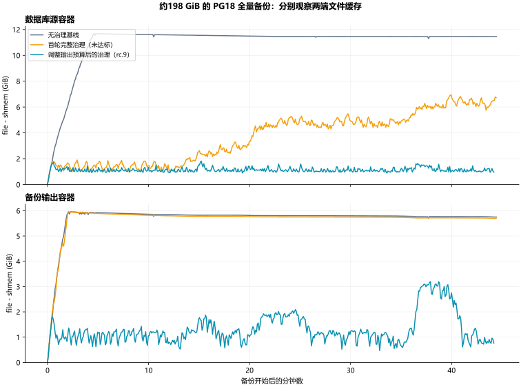
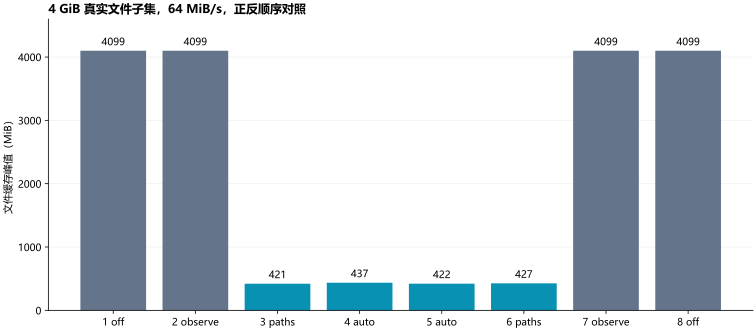

# 最终实验汇总：rc.9 候选版

本报告区分功能正确、缓存效果和上线验收。当前结论是：程序已具备可交付的两种范围模式，真实规模试验有明确效果与资源代价；尚不能声称任意业务不再发生驱逐。

## 实验条件

Linux 5.14、cgroup v2、containerd、PG18.6，4KiB页。完整迁移数据约198GiB、1428业务模式、10217物理表/分块、642157127行，迁移升级前后已经逐表审计一致。实验另建副本，保留原始基准。数据库限额12GiB、工作容器6GiB，原生pg_basebackup限制96MiB/s。

CCG源端工作预算100ms/秒、初始/最大建议128/160MiB/s；最终输出端200ms/秒、192/256MiB/s、驻留查询覆盖2GiB/s。其余值见[实验配置](CONFIGURATION.zh.md#实验配置与默认配置不同)。这些不是默认低预算配置。IO PSI接口缺失，本实验明确禁用该保护，没有假装保护生效。

## 全量备份结果

| 指标 | 无治理基线 | 最终输出预算配置 |
| --- | ---: | ---: |
| 备份时长（秒） | 2671.72 | 2656.11 |
| 源cgroup file峰值（GiB，包含shmem） | 11.924 | 2.070 |
| 输出cgroup file峰值（GiB） | 5.958 | 3.193 |
| 结束后源目录独立驻留（GiB） | 11.414 | 0.899 |
| 结束后输出目录独立驻留（GiB） | 5.744 | 0.419 |
| 查询p95（ms，备份及校验整窗口） | 45.151 | 45.327 |
| 查询p99（ms，同上） | 47.512 | 46.350 |
| 原生pg_verifybackup | 通过 | 通过 |
| 新增OOM kill（源/工作容器） | 0/0 | 0/0 |

按普通文件近似量file-shmem的**峰值增量**计算，源端下降84.87%，输出端下降46.42%。此前提出的“≥70%”是实验目标：源端达到，输出端未达到；不把四舍五入或末值下降冒充峰值达标。缓存也没有归零。备份时长变化-0.58%，这是单次完整对照的观察，不是所有业务的统计保证。

图使用file-shmem，表格另列原始file，避免共享内存口径混用。样本之间仍可能存在未捕获的短时峰值。源和输出驻留在备份结束、原生校验开始前测量，防止把校验重读混入备份缓存结论。基线未保留精确阶段起始时间，因此延迟对照统一使用备份+校验窗口，没有伪造“仅备份p99”。

**校验阶段是一个未解决的资源边界：** pg_verifybackup没有沿用pg_basebackup的限速；其间输出端file峰值为5.758GiB，active_file峰值0.3MiB。它没有保持备份阶段较低的缓存水平。基线没有同窗口缓存采样，不能编造校验阶段改善比例。本版只对释放动作设置预算，不能给任意速度的数据输入建立缓存硬上限；后续应将校验等任务的读取吞吐一起纳入上层或经验证的cgroup IO预算。本实验没有由CCG自动改写这些限额。

## 控制器本身的代价

| 控制器 | 平均单核CPU | 采样CPU峰值 | 采样RSS峰值 |
| --- | ---: | ---: | ---: |
| 源端 | 10.38% | 15.49% | 40.4MiB |
| 输出端 | 19.47% | 23.12% | 41.4MiB |

CPU均值按采样首尾进程CPU累计时间除以墙钟时间计算。数值以一个逻辑核为100%，不是整机百分比。RSS没有覆盖由文件遍历引起的全部内核slab成本，内核分类另保留在汇总JSON。软件预算不能当成内核硬限额。

## 磁盘观察

以下仅比较同一logical device 253:0的cgroup增量，不与其下层设备重复相加，也不冒充磁盘硬件实测峰值。

| 指标 | 基线 | 最终配置 |
| --- | ---: | ---: |
| 源端读字节（GiB） | 197.974 | 197.961 |
| 输出端写字节（GiB） | 198.007 | 198.010 |
| 源端读IO次数 | 276520 | 296163 |
| 输出端写IO次数 | 357031 | 352447 |

累计量不能代替瞬时排队与业务fsync时延；本轮未部署同机etcd、Redis、Prometheus压力源。因此不以这些数字证明所有共享磁盘服务均不受影响。

## 两种模式与重复读取

早期rc.6在4GiB真实文件子集、64MiB/s下完成off/observe/paths/auto及反向八相：无治理/观察峰值约4099MiB，执行模式约421–437MiB；观察模式建议量为0。这个约89%的子集改善不能替代上面的完整规模结果。

最新二进制又完成同一4GiB工作集两遍读取，合计8GiB，并叠加每10ms一次、8KiB随机热点读。以下是模拟访问，不是完整DBS自动任务重放。

| 相次/模式 | file峰值MiB | active_file峰值MiB | 块设备读GiB | 热点p99 ms | 读取错误 |
| --- | ---: | ---: | ---: | ---: | ---: |
| 1/off | 4099.3 | 0.0 | 4.003 | 0.037709 | 0 |
| 2/paths | 603.6 | 0.0 | 8.028 | 2.823435 | 0 |
| 3/auto | 697.8 | 0.0 | 8.027 | 4.685804 | 0 |
| 4/off | 4099.3 | 0.0 | 4.003 | 0.037760 | 0 |

主动释放会使再次扫描重新读盘；应结合表中实际读字节判断代价，不能把缓存小作为唯一成功条件。这里的热点p99从约0.038ms升至2.823/4.686ms，不能当成可以忽略的测量噪声，**低业务影响目标未通过**。热点是文件读取探针，不等于完整SQL业务，但已足以否定高强度治理对任意热点都无害的说法。active_file列只证明对应模拟条件，不将小工作集写成复现了原环境二十多GB峰值。

## 补充：明确排除热点文件

使用同一二进制、同一4GiB两遍读取和热点探针，增加独立off/paths+exclude/off对照。唯一策略变化是将探针所在整个文件加入exclude_paths；冷起始仅作用于实验副本。它验证用户明确提供的排除策略，不代表程序已经自动识别业务热页，也不抵消前一组未达标结果。

| 相次/模式 | file峰值MiB | 块设备读GiB | 热点p99 ms | 错误数 |
| --- | ---: | ---: | ---: | ---: |
| 1/off | 4099.3 | 4.003 | 0.036178 | 0 |
| 2/paths | 485.3 | 7.880 | 0.048157 | 0 |
| 3/off | 4099.3 | 4.003 | 0.036607 | 0 |

热点p99回到约0.048ms，相比未排除时的数毫秒明显改善；但仍高于这一轮off的约0.037ms，不能记为相对劣化≤5%已通过。即使热点排除有效，其他已释放数据的再次扫描仍会增加读盘。文件重写或关系映射变化后要重新确认排除范围；不能假定PG物理文件名永久不变。

## 恢复、跨容器与二进制

最终完整备份通过原生校验后，另建reflink恢复副本并实际启动PG18，核对模式目录、关系目录与测试表查询结果均与源实例一致，再正常关闭该恢复实例。第一次恢复脚本因PID1退出时内部pg_ctl会话结束而未保存完整报告；PG日志显示正常关闭。修正为从容器外确认关闭后，从新副本重新做完整恢复并通过，未将首次脚本失败掩盖。reflink准备与恢复启动不等于远端下载、解压、增量链合并或生产应用恢复RTO；这些未纳入新守护程序职责。

治理程序与数据库分属两个容器，OCI配置确认源数据只读挂载，双方stat确认同设备、同inode、同UID。结合源端驻留变化，确认本环境中跨容器释放建议可行。复制到另一个inode的数据不是共享同一份缓存，其他文件系统/UID/SCC条件需各自验证。

amd64实机静态程序与arm64原生CI产物均提供；[rc.9 CI](https://github.com/cuipengdba/ContainerCacheGuard/actions/runs/42191141383)已核对原始unit/race/CLI日志。ARM测试内核为4KiB页，未声称64KiB页通过。发布附构建来源、SHA256及许可证。

## 保留失败，明确尚未完成

- 首轮guard-r6完成备份和校验，但源峰值7.19GiB、输出5.95GiB，未达到缓存目标。
- guard-r8因输出积累约6GiB，在约1136秒时主动中断；没有将这份不完整备份计为成功。
- guard-r9修正延后重试后完成并校验通过，源峰值约2.06GiB；输出后半程仍升至约5.81GiB。最终guard-r10保留同一rc.9二进制，单独提高输出治理预算，再做完整对照。性能改善同时包含代码与配置选择的作用。
- 两次早期CI曾被管道吞掉失败退出码，后续下载原日志发现并修正。原记录和原因见[过程报告](TESTING.zh.md)，不计为整套通过。
- 本机没有运行kubelet，不能替代真实Kubernetes/OpenShift驱逐验收；72小时长稳、ARM64 64KiB页、完整DBS二进制调度接入与同机关键服务压力仍未完成。
- 本轮完整数据约198GiB，不是1.5TB；只复用hisdbs真实副本，没有独立迁移另一份DBS库。当前产品主动治理普通磁盘文件缓存，其它缓存仅监测解释。

可核对的去敏数字见[实验汇总JSON](results/lab-summary.json)。源数据、原始表名、连接信息和原始内部日志不上传公开仓库。
